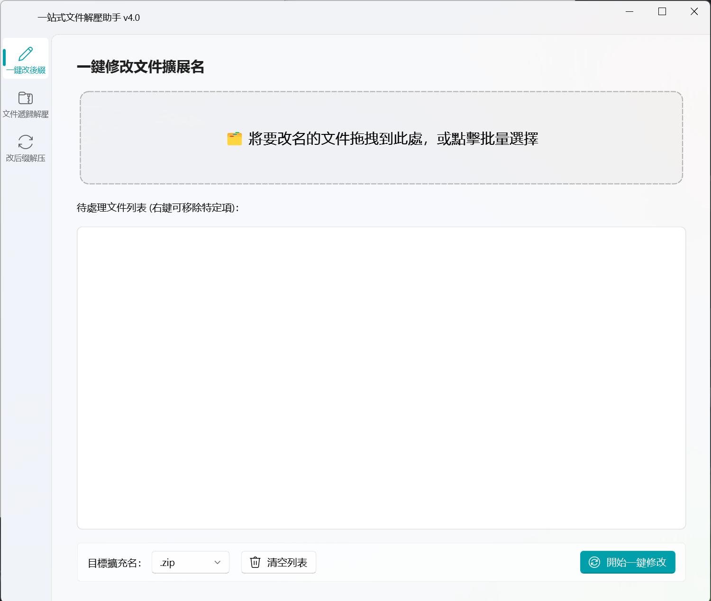
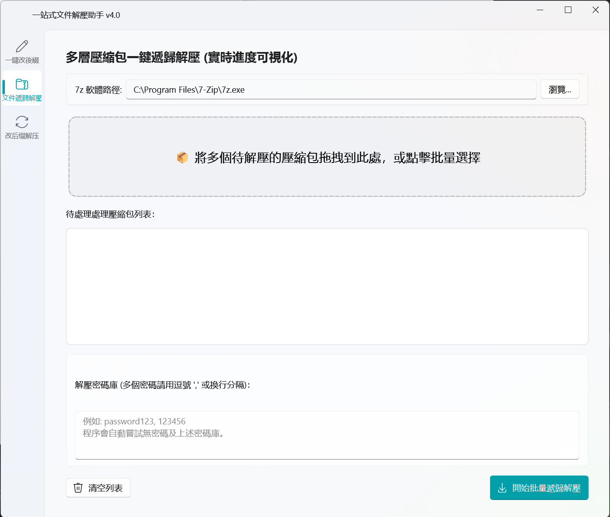
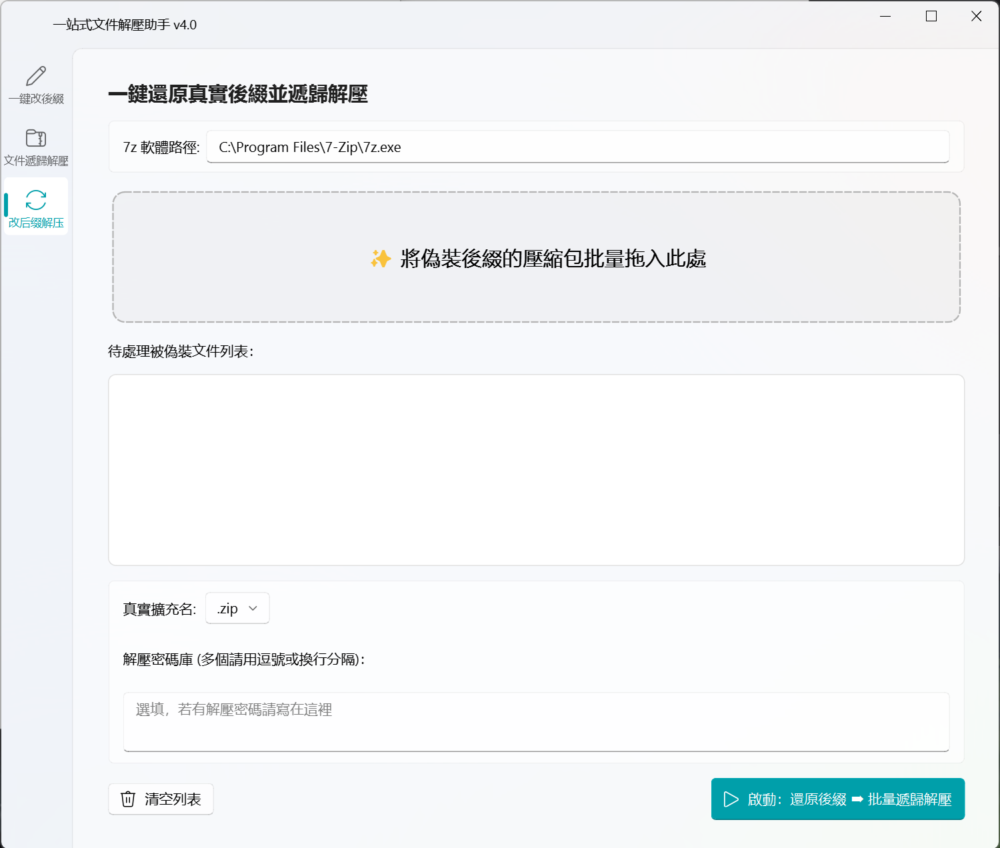

# Auto7z — 一站式文件解壓與後綴還原助手

`Auto7z` 是一款基於 **PyQt-Fluent-Widgets**開發的桌面端高效文件管理與解壓工具。

主要為了解決日常下載文件時遇到的「後綴被偽裝」、「多層壓縮包嵌套、層層密碼手動解壓繁瑣」等問題而設計。通過 `7z.exe` 後台解壓與多線程架構，實現高效的自動化批量處理。

## ✨ 核心功能

1. **一鍵改後綴 (Extension Changer)**
   - 支持多文件批量拖入、拖拽管理。
   - 一鍵將各種類型的文件擴展名（如 `.zip`, `.rar`, `.7z`, `.png`, `.mp4`）統一修改為目標後綴，告別手動逐個重命名的痛苦。
2.  **多文件遞歸解壓 (Auto Extractor)**
   - 內置強大的**遞歸解壓引擎**。當壓縮包內還嵌套著其他壓縮包時，程序會自動深層掃描並完全釋放，直到所有嵌套包解壓完畢。
   - **智慧密碼庫**：支持同時輸入多個可能性的密碼（用逗號或換行分隔），程序會自動為每個壓縮包輪詢匹配正確的密碼，實現全自動無人值守解壓。
3. **一鍵全自動聯動 (All-in-One)**
   - **最強聯動模式**：針對網盤下載的「偽裝後綴壓縮包」（例如為了防和諧而把 `.7z` 改成 `.png` 的文件）。
   - 只需將文件拖入，選擇真實的擴展名，程序會**自動還原真實後綴 ➡️ 自動匹配密碼 ➡️ 自動執行多層遞歸解壓**，一氣呵成。

## 🚀 快速開始

### 環境依賴

在運行或打包本程序前，請確保安裝了以下 Python 庫：

```
pip install PyQt5
pip install "PyQt-Fluent-Widgets[full]" -i https://pypi.org/simple/
```

> **注意**：本工具後台依賴 `7-Zip` 核心。程序會自動嘗試檢索系統中 `C:\Program Files\7-Zip\7z.exe` 默認安裝路徑，你也可以在界面中手動瀏覽指定，或直接將 `7z.exe` 放置在代碼根目錄下。

### 運行程序

```
python main.py
```

## DEMO

一鍵修改文件擴展名，支持拖入文件和批量處理。



多層壓縮包一鍵遞歸解壓，能夠自動將多層壓縮包解壓到底，並將多餘的壓縮包刪除。同時，能夠自動匹配正確的密碼。



一鍵還原文件後綴並遞歸解壓，上面兩個功能的合併。



## 📦 程序打包 (Distribution)

本項目已完全適應 `PyInstaller` 打包機制，根目錄內置 `ys.ico` 圖標。

### 方案 A：打包成單個獨立 EXE（方便分發分享）

```
pyinstaller --noconsole --onefile --icon=ys.ico --name="Auto7z" main.py
```

### 方案 B：打包成文件夾模式（啟動速度最快）

```
pyinstaller --noconsole --onedir --icon=ys.ico --name="Auto7z" main.py
```

打包完成後，前往 dist/Auto7z 目錄下即可運行。建議將 7z.exe 複製一份放置在 Auto7z.exe 的同級目錄下，體驗最佳。

## 📂 項目結構

```
Auto7z/
│
├── main.py              # 程序主入口及所有 GUI 邏輯
├── Auto7z.ico          # 程序圖標
├── 7z.exe                 # 7-Zip 後台執行核心（選填，放同級目錄可免配置）
└── README.md       # 項目說明文件
```

## 📜 許可證

本项目基于 [MIT License](https://www.google.com/search?q=LICENSE&authuser=1) 許可證開源。