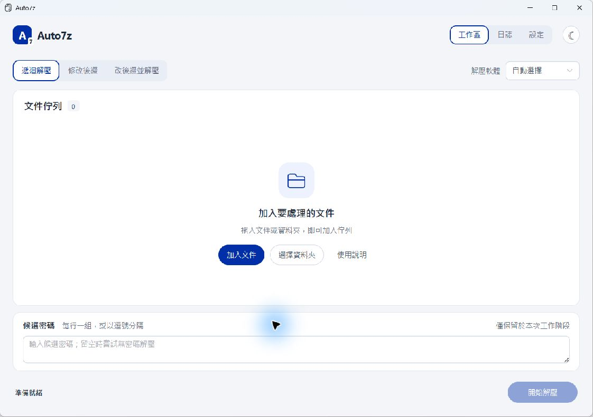

# Auto7z 7.0.0

Windows 批量解壓與後綴處理工具。Vue 3 + Element Plus + Tauri 2 桌面界面，重用獨立 Python 解壓核心，內附 7-Zip。



## 下載與啟動

[最新 Release](https://github.com/MostimaJK/Auto7z/releases/latest)

| 檔案 | 使用方式 |
| --- | --- |
| [單 EXE](https://github.com/MostimaJK/Auto7z/releases/download/v7.0.0/Auto7z-v7.0.0-Windows-x64-Single.exe) | 直接執行；首次會校驗並釋放內嵌依賴到獨立版本快取 |
| [含依賴便攜 ZIP](https://github.com/MostimaJK/Auto7z/releases/download/v7.0.0/Auto7z-v7.0.0-Windows-x64-Portable.zip) | 完整解壓，執行 Auto7z/Auto7z.exe；保留同級 resources |
| [安裝版](https://github.com/MostimaJK/Auto7z/releases/download/v7.0.0/Auto7z-v7.0.0-Windows-x64-Setup.exe) | 執行安裝程式 |

適用 Windows 10／11 x64，需要 Microsoft Edge WebView2 Runtime。單 EXE 啟動器另使用 Windows .NET Framework 4.8；Windows 10 22H2／11 通常已提供。上述版本均包含 Python 後台和 7-Zip，不需另裝 Python、Node.js 或 Rust。SHA256SUMS.txt 與原始碼一同提供；不包含 WinRAR，若需要請自行安裝並於設定中選擇。

「單 EXE」指下載及入口為一個檔案，並非完全不寫入磁碟或內嵌 WebView2；內嵌檔案逐一校驗後釋放至 `%LOCALAPPDATA%/Auto7z/Runtime/<版本及內容雜湊>/`。後續啟動重用已校驗快取，並不清理使用者文件或配置。

## 功能

- 直接選擇遞迴解壓、修改後綴、改後綴並解壓；後綴可搜尋19種常見格式或自訂，輸入後按 Enter，支援 .tar.gz 等複合後綴。改後綴只改檔名，不轉換壓縮格式。
- 文件／資料夾拖入、原生多選、資料夾遞迴掃描與分卷首卷辨識。常駐候選密碼按行或逗號分隔，工作階段內優先重用成功密碼。
- 7-Zip 實際回報目前壓縮包本次嘗試的百分比，與整批文件完成數分開；內層包／密碼重試重置範圍，未知進度不造數字。WinRAR／預檢使用活動狀態，不估算剩餘時間。
- 後台處理解壓及掃描，可取消、重試未成功項；成功結果保留，外層原包保留，同名結果另建目錄。部分完成重試重新解壓，並非斷點續傳。
- 文件詳情查看與開啟結果；獨立日誌頁可選取／複製最近2,000筆活動與有界診斷，不宣稱收錄全部原始輸出。
- 設定頁選內置／自訂7-Zip、選填WinRAR、遞迴深度、預檢逾時、停滯保護及內層刪除偏好。工具路徑檢查是存在性檢查，不能替代實際執行相容性驗證。
- 克萊因藍強調色、200ms滑動分段導航、繁體中文、明暗／系統主題、鍵盤焦點與短窗口布局。Ctrl+O 加文件、Ctrl+Shift+O 加資料夾、Ctrl+Enter 開始。

設定保存在 `%APPDATA%/local.auto7z.element/settings.json`，沿用試用版識別碼以保留設定。首次開發啟動可只讀匯入根目錄舊設定。密碼、佇列與日誌不跨啟動保存；清空佇列不刪磁碟結果。

## 原始碼開發

Windows 開發需要 Python 3.11+、Node.js（建議22.12+或24）、Rust stable MSVC、Visual Studio C++建置工具／Windows SDK及WebView2。後台僅使用標準庫；優先使用根目錄 .venv 的Python，否則使用PATH的Python。

```powershell
cd desktop
npm ci
$env:PATH="$env:USERPROFILE/.cargo/bin;"+$env:PATH
npm run desktop
```

根目錄 `Start_Auto7z.bat` 優先開啟已編譯release／debug，沒有產物才進入開發模式。編輯界面時使用 `npm run desktop` 以啟用熱更新。`npm run dev` 只有瀏覽器版面預覽，不能執行本機解壓。

## 建置發行包

```powershell
python -m venv .build-venv
./.build-venv/Scripts/python.exe -m pip install -r requirements-build.txt
cd desktop
npm ci
cd ..
./Build_Release.bat
```

一鍵腳本依序建置獨立後台、授權聲明、前端／Tauri、NSIS、便攜ZIP與單EXE；輸出至 `release/7.0.0/`。單EXE使用Windows內建.NET Framework C#編譯器，不需NuGet依賴。打包採明確允許清單，不收錄設定、密碼、WinRAR、照片、虛擬環境或歷史產物。完整重建需要網絡下載鎖定依賴；套件版本見package-lock.json與Cargo.lock。

## 測試與維護

```powershell
python -m unittest discover -s tests -v
python -m unittest discover -s desktop/tests -v
python scripts/verify_release.py
```

核心及橋接測試涵蓋真實7-Zip／WinRAR、多密碼、加密分卷、遞迴、重試、取消、長路徑及後綴安全。部分耗時／輸出協議測試使用明確標示的模擬子進程，不能當成真實解壓效能基準。發行驗證另檢查兩種包的檔案雜湊、獨立後台實際解壓、單檔冷／暖快取及並行準備。原生界面與效能檢查範圍見 [驗證記錄](docs/VALIDATION.md)。

7.0 已移除退休的 PyQt、C++/Qt、Fluent預覽與舊打包入口，保留原有獨立解壓核心。舊版原始碼及安裝包可從 [v6.1.0](https://github.com/MostimaJK/Auto7z/releases/tag/v6.1.0) 與Git歷史取得；DEMO素材與進度設計參考保留。現行架構見 [desktop/README.md](desktop/README.md)。

## 授權

本專案採GNU GPL v3，見 [LICENSE](LICENSE)。第三方聲明見 [THIRD_PARTY_NOTICES.md](THIRD_PARTY_NOTICES.md) 與發行包內 resources/licenses。7-Zip使用原版二進位；WinRAR不隨包分發。已知系統要求、變更及限制見 [更新紀錄](CHANGELOG.md)。
